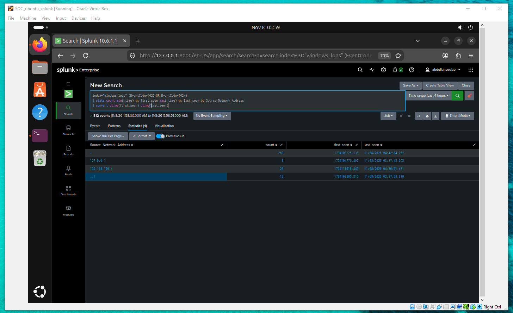

# SOC Level 1 Home Lab

### Security Monitoring | Threat Detection | Incident Investigation | Splunk SIEM

A hands-on Security Operations Center (SOC) Level 1 project focused on building a virtualized security monitoring environment, analyzing Windows authentication events, and documenting security investigations using Splunk Enterprise.

**Project Status:** Active Development

---

## Project Overview

This project demonstrates practical SOC Analyst Level 1 skills through a virtualized cybersecurity lab built using Oracle VirtualBox.

The environment includes Kali Linux for authorized security testing, Windows 10 as the monitored endpoint, and Ubuntu Linux hosting Splunk Enterprise for security event analysis.

The project focuses on developing skills in log analysis, authentication monitoring, security investigation, and technical documentation.

## Lab Architecture

| System | IP Address | Role |
|---|---|---|
| Kali Linux | 192.168.100.4 | Authorized security testing |
| Windows 10 | 192.168.100.50 | Monitored endpoint |
| Ubuntu Linux | 192.168.100.5 | Splunk SIEM server |

**Virtualization:** Oracle VirtualBox  
**Network:** SOC Lab – NAT Network  
**Subnet:** 192.168.100.0/24

All three virtual machines are connected through the same NAT Network.

Six bidirectional ICMP connectivity tests were completed successfully with 0% packet loss.

[View Network Architecture](architecture/network-architecture.md)

## Tools & Technologies

| Technology | Application |
|---|---|
| Splunk Enterprise 10.6.1.1 | SIEM and log analysis |
| Splunk SPL | Security event searching and correlation |
| Oracle VirtualBox | Virtualization |
| Kali Linux | Controlled security testing |
| Windows 10 | Authentication event generation |
| Ubuntu Linux | Splunk hosting and analysis |
| Windows Security Event Logs | Authentication monitoring |

## Practical Achievements

### 1. Virtual Network Configuration

Configured three virtual machines within a shared VirtualBox NAT Network and verified communication between all systems.

**Result:** 6/6 connectivity tests passed.

### 2. Windows Authentication Monitoring

Analyzed Windows authentication events in Splunk using the `windows_logs` index.

Relevant Event IDs:

- **4624:** Successful Logon
- **4625:** Failed Logon

### 3. Suspicious Authentication Activity Analysis

Used SPL queries to examine:

- Failed authentication attempts.
- Multiple account names associated with source IP addresses.
- Successful versus failed logon events.
- Authentication activity over time.

In one documented four-hour search window, 312 authentication events were returned, including 23 events associated with the Kali Linux IP address.

These observations are not sufficient on their own to confirm a specific attack technique or successful compromise.

### 4. Security Investigation Documentation

Created an initial SOC Level 1 investigation report based on observed Windows authentication activity.

The report includes evidence, preliminary findings, investigation limitations, and recommended next steps.

[Read Investigation 001](investigations/incident-001.md)

## Splunk Detection Queries

Example – Failed Windows Login Attempts:

```spl
index="windows_logs" EventCode=4625
| stats count by Account_Name, Source_Network_Address
| sort -count
```

This query identifies failed authentication events grouped by account and source IP.

[View All Detection Queries](detections/windows-authentication-detection.md)


## Lab Evidence

### Failed Windows Authentication Attempts


### Authentication Activity by Source IP



### Successful vs Failed Logins


## Investigation Evidence

Screenshots of network connectivity tests and Splunk authentication analysis are available in the repository.

[View Screenshots](screenshots/)

## Project Documentation

| Section | Description |
|---|---|
| [Architecture](architecture/network-architecture.md) | Network design, virtual machines, and connectivity |
| [Setup](setup/lab-setup.md) | Infrastructure and environment configuration |
| [Detections](detections/windows-authentication-detection.md) | Splunk SPL detection and analysis queries |
| [Investigations](investigations/incident-001.md) | SOC Level 1 authentication investigation |
| [Screenshots](screenshots/) | Practical lab evidence |

## Skills Demonstrated

- SOC Level 1 monitoring fundamentals
- Windows Security Event Log analysis
- Splunk Search Processing Language (SPL)
- Authentication event investigation
- Source IP and account activity analysis
- Virtual network configuration
- Security investigation documentation
- Evidence-based incident triage

## Future Development

- Verify and document the Windows log forwarding mechanism.
- Develop additional detection rules and alerts.
- Create Splunk security monitoring dashboards.
- Analyze additional Windows security events.
- Expand incident investigation scenarios.
- Improve reproducibility of the lab setup.

## Security Disclaimer

All activities are conducted within an authorized cybersecurity home lab for educational and defensive security research purposes.

The project does not claim a confirmed compromise or production SOC deployment.
