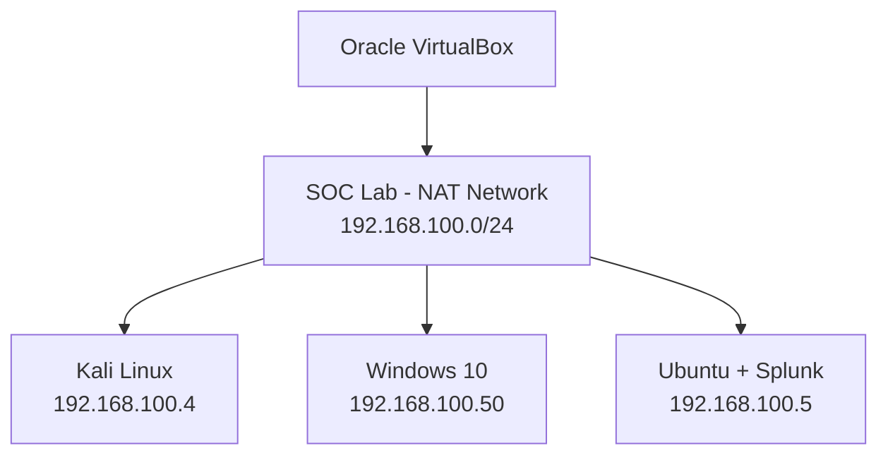

# SOC L1 Home Lab – Network Architecture

## 1. Overview

This document describes the network architecture of a virtualized Security Operations Center (SOC) Level 1 home lab.

The environment is designed for hands-on security monitoring, log analysis, threat detection, and incident investigation using Splunk.

The lab consists of three virtual machines hosted on Oracle VirtualBox and connected through a shared NAT Network.

**Network Connectivity Status:** Verified – 6/6 ICMP connectivity tests successful.

## 2. Network Configuration

| Parameter | Configuration |
|---|---|
| Virtualization Platform | Oracle VirtualBox |
| Network Name | SOC Lab |
| Network Type | NAT Network |
| Subnet | 192.168.100.0/24 |
| Connected Virtual Machines | 3 |
| Adapter 1 | NAT Network |
| Adapter 2 | Disabled |

## 3. Virtual Machines

| Virtual Machine | IP Address | Role |
|---|---|---|
| Kali Linux | 192.168.100.4 | Controlled attack simulation |
| Windows 10 | 192.168.100.50 | Target system and security event generation |
| Ubuntu Linux | 192.168.100.5 | Splunk server and security analysis |

### Kali Linux

Used for authorized attack simulations and generating security activity within the lab environment.

### Windows 10

Serves as the target endpoint for security testing and Windows event log generation.

### Ubuntu Linux

Hosts the Splunk environment used for centralized security monitoring, event analysis, and investigation.

## 4. Network Topology

## 5. Connectivity Verification

ICMP connectivity was tested between all three virtual machines.

| Source | Destination | Result |
|---|---|---|
| Kali Linux | Windows 10 | PASS |
| Kali Linux | Ubuntu | PASS |
| Windows 10 | Kali Linux | PASS |
| Windows 10 | Ubuntu | PASS |
| Ubuntu | Kali Linux | PASS |
| Ubuntu | Windows 10 | PASS |

**Results: 6/6 tests passed (100%).**

These results confirm bidirectional ICMP connectivity between all three virtual machines.

Successful ICMP connectivity does not independently verify application-level communication or security log ingestion.

## 6. Security Monitoring Workflow

The intended monitoring workflow is:

1. Generate controlled security events within the lab.
2. Collect Windows security event logs.
3. Forward or ingest relevant events into Splunk.
4. Analyze events using Splunk Search Processing Language (SPL).
5. Investigate suspicious activities and document findings.

The log collection and ingestion mechanism will be documented after verification.

## 7. Next Steps

- Verify access to the Splunk web interface.
- Identify the Windows log collection method.
- Confirm Windows security events are indexed in Splunk.
- Create and test SPL detection queries.
- Document security investigations with supporting evidence.

## 8. Disclaimer

This lab is intended exclusively for authorized cybersecurity education, defensive monitoring, and controlled security testing.
