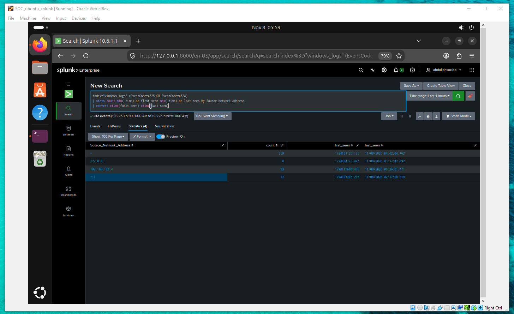

# Investigation 001 – Windows Authentication Activity

## 1. Executive Summary

This investigation examines Windows authentication events collected and analyzed using Splunk Enterprise in a controlled SOC Level 1 home lab.

Multiple failed authentication attempts involving different account names were observed. The source IP address `192.168.100.4`, assigned to the Kali Linux virtual machine, appeared repeatedly in the results.

The activity warrants further investigation to determine whether it represents simulated password spraying, brute-force attempts, or other authorized lab activity.

**Investigation Status:** In Progress  
**Severity:** Undetermined  
**Environment:** Authorized SOC Home Lab

## 2. Lab Environment

| Component | Configuration |
|---|---|
| SIEM Platform | Splunk Enterprise 10.6.1.1 |
| Virtualization | Oracle VirtualBox |
| Network | SOC Lab NAT Network |
| Subnet | 192.168.100.0/24 |
| Kali Linux | 192.168.100.4 |
| Windows 10 | 192.168.100.50 |
| Ubuntu / Splunk | 192.168.100.5 |
| Splunk Index | `windows_logs` |

## 3. Investigation Objectives

- Identify failed Windows authentication attempts.
- Determine which accounts were involved.
- Identify source IP addresses associated with authentication activity.
- Compare successful and failed authentication events.
- Document observations and determine appropriate next investigation steps.

## 4. Relevant Windows Event IDs

| Event ID | Description |
|---|---|
| 4624 | Successful account logon |
| 4625 | Failed account logon |

## 5. Evidence and Findings

### Finding 01 – Failed Authentication Attempts

Splunk searches identified multiple Event ID 4625 records.

Different account names appeared in the failed authentication results, including `admin`, `administrator`, and several test-user names.

These findings demonstrate repeated failed authentication activity within the lab.

### Finding 02 – Authentication Activity by Source IP

A search grouping authentication events by source IP returned the following results:

| Source IP | Event Count |
|---|---:|
| Unspecified / missing source | 269 |
| 192.168.100.4 | 23 |
| ::1 | 12 |
| 127.0.0.1 | 8 |
| **Total** | **312** |

The results include successful and failed authentication events from a specific four-hour search window.

The source `192.168.100.4` corresponds to Kali Linux in the lab.

### Finding 03 – Multiple Account Names

Another Splunk search returned 23 authentication events associated with source IP `192.168.100.4`, involving 11 distinct account-name values.

This observation is relevant to investigating authentication attempts against multiple accounts.

However, the query included both successful and failed logon events, so these results alone cannot establish password spraying.

### Finding 04 – Successful and Failed Logon Comparison

Splunk was used to compare Event ID 4624 and Event ID 4625 by account name and source IP address.

The results included failed authentication attempts across several account names and successful authentication events.

Further event-level correlation is required to establish whether any successful logon was related to preceding failures.

## 6. Preliminary Analysis

The observed authentication activity includes:

- Repeated failed login attempts.
- Multiple account names.
- Authentication events associated with Kali Linux.
- Successful and failed logon records in the same monitored environment.

Potential explanations include authorized attack simulation, repeated credential testing, or normal lab activity.

The available aggregated results are insufficient to confirm a specific attack technique or successful compromise.

## 7. SOC Analyst Assessment

**Current Classification:** Authentication activity requiring investigation.

**Severity:** Not yet determined.

**Confirmed Compromise:** No evidence established from the reviewed aggregated results.

**Recommended Actions:**

1. Review individual Windows authentication events.
2. Validate Logon Type and authentication failure codes.
3. Correlate event timestamps and source addresses.
4. Confirm which lab actions generated the observed events.
5. Determine whether the activity matches a simulated attack scenario.

## 8. Investigation Status

**In Progress**

The initial Splunk queries and observations have been documented. Additional event validation is required before reaching a final conclusion.

## 9. Lessons Learned

This exercise demonstrates practical experience with:

- Windows Security Event IDs.
- Splunk Search Processing Language (SPL).
- Authentication event monitoring.
- Source IP analysis.
- Account-based event aggregation.
- Preliminary SOC Level 1 investigation and documentation.

## 10. Disclaimer

All testing and analysis are conducted in an authorized virtual lab environment for educational and defensive cybersecurity purposes.
